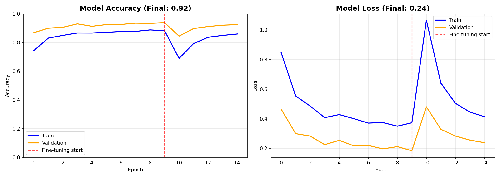

# 🌱 AgroDetect AI — Plant Disease Detection System

  
  
  
  

---

## 📌 Project Overview

**AgroDetect AI** is a deep learning–based web application that detects plant leaf diseases from images and provides intelligent treatment recommendations.

The system helps farmers, researchers, and agriculture students quickly identify plant health issues using Artificial Intelligence.

---

## 🎯 Key Features

- 🔍 Instant plant disease detection  
- 🎯 ~92–95% model accuracy  
- 💊 Automated treatment recommendations  
- 📊 Confidence score display  
- 🌿 Prevention tips  
- 🎨 Modern interactive UI  
- ⚡ FastAPI high-performance backend  

---

## 🏗️ System Architecture

User → Streamlit Frontend → FastAPI Backend → CNN Model → Prediction → Treatment Advice

---

## 🧠 Technologies Used

### 👨‍💻 Programming
- Python 3.11

### 🤖 Machine Learning
- TensorFlow / Keras  
- NumPy  
- Pillow  

### 🌐 Backend
- FastAPI  
- Uvicorn  

### 🎨 Frontend
- Streamlit  

---

## 📊 Model Training Performance

The model was trained using transfer learning and fine-tuning.

> ⚠️ Keep this file in project root: **training_history.png**

**Final Results**

- Validation Accuracy: ~92–95%  
- Validation Loss: ~0.24  
- Good generalization with minimal overfitting  

---

## 🖥️ Application Screenshots

> ⚠️ Place these images in project root with exact names.

### 🏠 Home Screen  

### 📤 Image Upload  

### ✅ Prediction Result  

---

## 📁 Project Structure

AgroDetect-AI  
├── backend  
├── frontend  
├── utils  
├── requirements.txt  
├── train_model.py  
├── training_history.png  
└── README.md  

---

## 🧪 How to Use

1. Open the Streamlit web app  
2. Upload a plant leaf image  
3. Click **Analyze Disease**  
4. View prediction, confidence, treatment, and prevention tips  

---

## 🔮 Future Enhancements

- 📱 Mobile application  
- ☁️ Cloud deployment  
- 🎥 Real-time camera detection  
- 🌾 Multi-crop expansion  
- 🤖 Farmer advisory chatbot  

---

## 👨‍🎓 Author

**Gorrela Sai Maneesh**  
B.Tech — Computer Science & Engineering  
Lovely Professional University  

---

⭐ **AgroDetect AI — Smart Farming with Artificial Intelligence**